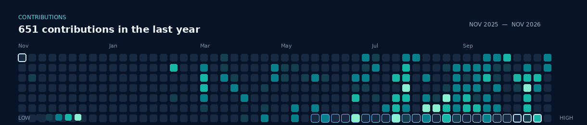

# Olamilekan Adebanjo

### Young aspiring startup founder · Web development · Learning in public

*Learning in public and turning ideas into useful things.*

---

## About me

I’m learning by building projects and sharing what I discover along the way. I started learning web development in late 2018 and have continued through online courses and hands-on practice. I now have a few projects in my name, and I’ll add them here as they’re ready to share.

## Contribution activity

*An animated snapshot of GitHub contribution activity from November 2025 to November 2026.*

## Languages & technologies

**Languages in my public repositories:** Go · TypeScript · Rust · JavaScript · Kotlin

**Learning and exploring:** Python · C++ · C# · Java · PHP · Ruby · HTML · CSS · React · Node.js · SQL · ROS

## AI, coding & learning tools

Claude · Codex · GitHub Copilot · Freebo · Coursera · Kilo Code · OpenCode · OpenAI · ChatGPT · Gemini · Antigravity

## Organizations

| Organization | Organization |
| --- | --- |
| [learn2earn](https://github.com/learn2earn) | [steller-flow-com](https://github.com/steller-flow-com) |
| [new-world-age](https://github.com/new-world-age) | [RAMPWATCH](https://github.com/RAMPWATCH) |
| [midnight-risein-com](https://github.com/midnight-risein-com) | [ARENA-AI-OS](https://github.com/ARENA-AI-OS) |
| [Comeback-Ai](https://github.com/Comeback-Ai) | [payflex-work](https://github.com/payflex-work) |
| [x402-llm-utils](https://github.com/x402-llm-utils) | [meterly-labs](https://github.com/meterly-labs) |
| [free-worldlife](https://github.com/free-worldlife) | [startup-DEV-life](https://github.com/startup-DEV-life) |
| [Nexus-Office-room](https://github.com/Nexus-Office-room) | [stellar-Current](https://github.com/stellar-Current) |

## What I’m focused on

- Growing my web development skills through hands-on work
- Building useful projects and learning from each one
- Exploring ideas that could grow into a startup
- Sharing what I learn along the way

## Projects

I’m preparing a project showcase. I’ll add project highlights here as I continue building.

## Find me online

---

*Building with purpose. Learning as I go.*

