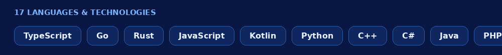
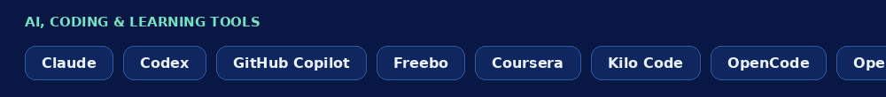
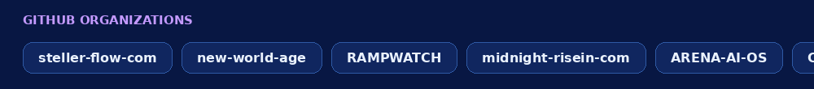
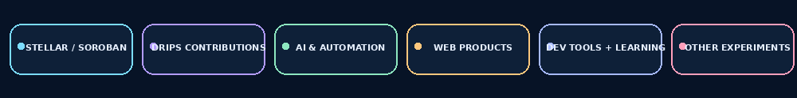

# Olamilekan Adebanjo

### Young aspiring startup founder · Web development · Learning in public

*Learning in public and turning ideas into useful things.*

---

## About me

I’m learning by building projects and sharing what I discover along the way. I started learning web development in late 2018 and have continued through online courses and hands-on practice. I now have a few projects in my name, and I’ll add them here as they’re ready to share.

## Contribution activity

<picture>
  <source media="(prefers-color-scheme: dark)" srcset="https://raw.githubusercontent.com/lekanay2005-coder/lekanay2005-coder/output/github-snake-dark.svg">
  <source media="(prefers-color-scheme: light)" srcset="https://raw.githubusercontent.com/lekanay2005-coder/lekanay2005-coder/output/github-snake.svg">
  
</picture>

*This contribution snake refreshes automatically each day.*

## Languages & technologies

**Languages in my public repositories:** Go · TypeScript · Rust · JavaScript · Kotlin

**Learning and exploring:** Python · C++ · C# · Java · PHP · Ruby · HTML · CSS · React · Node.js · SQL · ROS

## AI, coding & learning tools

Claude · Codex · GitHub Copilot · Freebo · Coursera · Kilo Code · OpenCode · OpenAI · ChatGPT · Gemini · Antigravity

## Organizations

| Organization | Organization |
| --- | --- |
| [learn2earn](https://github.com/learn2earn) | [steller-flow-com](https://github.com/steller-flow-com) |
| [new-world-age](https://github.com/new-world-age) | [RAMPWATCH](https://github.com/RAMPWATCH) |
| [midnight-risein-com](https://github.com/midnight-risein-com) | [ARENA-AI-OS](https://github.com/ARENA-AI-OS) |
| [Comeback-Ai](https://github.com/Comeback-Ai) | [payflex-work](https://github.com/payflex-work) |
| [x402-llm-utils](https://github.com/x402-llm-utils) | [meterly-labs](https://github.com/meterly-labs) |
| [free-worldlife](https://github.com/free-worldlife) | [startup-DEV-life](https://github.com/startup-DEV-life) |
| [Nexus-Office-room](https://github.com/Nexus-Office-room) | [stellar-Current](https://github.com/stellar-Current) |

## What I’m focused on

- Growing my web development skills through hands-on work
- Building useful projects and learning from each one
- Exploring ideas that could grow into a startup
- Sharing what I learn along the way

## Projects, organized

Here are my **80 public repositories**, grouped using their names and visible descriptions. Repositories marked **fork** are identified by GitHub as forks. Some projects have little public detail, so those groupings are broad until I add fuller descriptions.

<strong>🌌 Stellar & Soroban · 32 repositories</strong>

- [agora](https://github.com/lekanay2005-coder/agora) · fork — Agora is an event and ticketing platform built for organizers, creators, and communities to create events, sell tickets, and manage attendees with…
- [Anchorage](https://github.com/lekanay2005-coder/Anchorage) · fork — A SEP-10 authentication server for Stellar, written in Go.
- [astroid-api](https://github.com/lekanay2005-coder/astroid-api) · fork — NestJS backend - the intelligence layer of Astroid on Stellar
- [astroid-contract](https://github.com/lekanay2005-coder/astroid-contract) · fork — Soroban smart contracts - the on-chain backbone of Astroid on Stellar
- [BettaPay-Contract](https://github.com/lekanay2005-coder/BettaPay-Contract) · fork
- [CraftNexus](https://github.com/lekanay2005-coder/CraftNexus) · fork — CraftNexus is a global digital marketplace that enables artisans to sell handcrafted products and educational courses directly to buyers worldwide. The…
- [Creditra-Contracts](https://github.com/lekanay2005-coder/Creditra-Contracts) · fork
- [Creditra-Frontend](https://github.com/lekanay2005-coder/Creditra-Frontend) · fork
- [marketplace](https://github.com/lekanay2005-coder/marketplace) · fork — The on-chain marketplace for authenticated African art.
- [mergepay-web](https://github.com/lekanay2005-coder/mergepay-web) · fork — Split expenses on Stellar, settle instantly, track everything transparently — neobrutalist Next.js frontend for Mergepay.
- [niff-Stellar-shurance](https://github.com/lekanay2005-coder/niff-Stellar-shurance)
- [pulsar](https://github.com/lekanay2005-coder/pulsar) · fork — An MCP Server for Stellar/Soroban. A Model Context Protocol (MCP) server that lets AI coding assistants (Cursor, Claude, Windsurf) natively interact…
- [Remitwise-Contracts](https://github.com/lekanay2005-coder/Remitwise-Contracts) · fork
- [soroban-cost-estimator](https://github.com/lekanay2005-coder/soroban-cost-estimator) · fork — This CLI tool wraps Stellar's simulateTransaction RPC to report real resource consumption (CPU instructions, memory, read/write entries/bytes, tx size,…
- [soroban-cost-linter](https://github.com/lekanay2005-coder/soroban-cost-linter) · fork — A static analysis linter for Stellar Soroban smart contracts to catch input-independent resource cost anti-patterns before deployment.
- [sorokeep](https://github.com/lekanay2005-coder/sorokeep) · fork — The missing operations layer for deployed Soroban smart contracts
- [soroscope](https://github.com/lekanay2005-coder/soroscope) · fork — Optimize your Soroban smart contracts. Visualize CPU, RAM, and Ledger footprint to reduce transaction fees and improve performance.
- [SoroTask](https://github.com/lekanay2005-coder/SoroTask) · fork — On most blockchains smart contracts just sit there — they only run when someone calls them. That makes recurring things like yield harvesting,…
- [SoroTrail](https://github.com/lekanay2005-coder/SoroTrail) · fork
- [Soter](https://github.com/lekanay2005-coder/Soter) · fork — Free, open-source tool for sending aid directly to people in need using the Stellar blockchain. Donors and NGOs create easy claim links; AI checks…
- [splitlock-app](https://github.com/lekanay2005-coder/splitlock-app) — Frontend, backend, indexer, and deployment tooling for SplitLock — a Stellar escrow split-payments dApp
- [splitlock-contract](https://github.com/lekanay2005-coder/splitlock-contract) — Soroban smart contract for SplitLock — proportional split-payment escrow on Stellar
- [stellar-agent-guard-dashboard](https://github.com/lekanay2005-coder/stellar-agent-guard-dashboard) · fork — Operator interface for Stellar Agent Guard: no-code guardrail configuration, real-time event telemetry, and panic-button freeze. Pure client-side…
- [stellar-bounty-board](https://github.com/lekanay2005-coder/stellar-bounty-board) · fork
- [stellar-goal-vault](https://github.com/lekanay2005-coder/stellar-goal-vault) · fork
- [stellar-intel](https://github.com/lekanay2005-coder/stellar-intel) · fork — Execution layer for stablecoin value on Stellar.
- [stellar-nebula-frontend](https://github.com/lekanay2005-coder/stellar-nebula-frontend) · fork
- [StellarCore](https://github.com/lekanay2005-coder/StellarCore) · fork — The intelligence layer for Stellar anchors.
- [stellarspend-contracts](https://github.com/lekanay2005-coder/stellarspend-contracts) · fork — Soroban smart contracts for automated budgets, savings goals, and spending limits on Stellar
- [stellopay-core](https://github.com/lekanay2005-coder/stellopay-core) · fork — a decentralized payroll system built on the Stellar blockchain using Soroban.
- [TrusTrove-app](https://github.com/lekanay2005-coder/TrusTrove-app) · fork — TrusTrove is a decentralized trade finance protocol on the Stellar blockchain. Small and medium businesses (SMEs) tokenize unpaid trade invoices as…
- [votechain-contracts](https://github.com/lekanay2005-coder/votechain-contracts) · fork

<strong>💧 Drips / Stellar Wave contributions · 1 repositories</strong>

- [sub-rosa-drips](https://github.com/lekanay2005-coder/sub-rosa-drips) · fork — Sub Rosa repository for Drips Stellar Wave contributions

<strong>🤖 AI & automation · 5 repositories</strong>

- [Ai](https://github.com/lekanay2005-coder/Ai)
- [comeback](https://github.com/lekanay2005-coder/comeback) · fork
- [Comeback.ai](https://github.com/lekanay2005-coder/Comeback.ai) · fork
- [solocart-ai](https://github.com/lekanay2005-coder/solocart-ai)
- [x402-llm-utils](https://github.com/lekanay2005-coder/x402-llm-utils)

<strong>🚀 Web apps & product builds · 24 repositories</strong>

- [Dongle-frontend](https://github.com/lekanay2005-coder/Dongle-frontend) · fork
- [drops](https://github.com/lekanay2005-coder/drops)
- [EliteWork](https://github.com/lekanay2005-coder/EliteWork) · fork
- [Fluxora-Frontend](https://github.com/lekanay2005-coder/Fluxora-Frontend) · fork
- [hackathons](https://github.com/lekanay2005-coder/hackathons)
- [hintents](https://github.com/lekanay2005-coder/hintents)
- [hunty](https://github.com/lekanay2005-coder/hunty) · fork
- [Liquifact-backend](https://github.com/lekanay2005-coder/Liquifact-backend) · fork
- [New-GenX](https://github.com/lekanay2005-coder/New-GenX)
- [new-line](https://github.com/lekanay2005-coder/new-line)
- [New-moon](https://github.com/lekanay2005-coder/New-moon)
- [nexusid-app](https://github.com/lekanay2005-coder/nexusid-app)
- [nrx](https://github.com/lekanay2005-coder/nrx) · fork
- [OFFER-HUB-Frontend](https://github.com/lekanay2005-coder/OFFER-HUB-Frontend) · fork
- [PetAd-backend](https://github.com/lekanay2005-coder/PetAd-backend) · fork — PetAd.
- [PetAd-Frontend](https://github.com/lekanay2005-coder/PetAd-Frontend) · fork — A platform for pet adoption and temporary pet custody with blockchain-backed trust guarantees.
- [predictify-frontend](https://github.com/lekanay2005-coder/predictify-frontend) · fork
- [QiuckEx](https://github.com/lekanay2005-coder/QiuckEx) · fork
- [Quittance](https://github.com/lekanay2005-coder/Quittance) · fork
- [Receiptor](https://github.com/lekanay2005-coder/Receiptor)
- [smart-age](https://github.com/lekanay2005-coder/smart-age)
- [teachLink_backend](https://github.com/lekanay2005-coder/teachLink_backend) · fork — Backend: Teachlink is a platform for technocrat where knowlege, skills, ideas, and information that can bring about development and improvement can be…
- [telegram-bot](https://github.com/lekanay2005-coder/telegram-bot)
- [Xelma-Frontend](https://github.com/lekanay2005-coder/Xelma-Frontend) · fork

<strong>🧰 Developer tools & learning projects · 16 repositories</strong>

- [AccordProtocol](https://github.com/lekanay2005-coder/AccordProtocol) · fork
- [alpha-game](https://github.com/lekanay2005-coder/alpha-game) · fork
- [ancore](https://github.com/lekanay2005-coder/ancore) · fork — monorepo for ancore
- [art](https://github.com/lekanay2005-coder/art)
- [art-2](https://github.com/lekanay2005-coder/art-2)
- [ascii-art-web](https://github.com/lekanay2005-coder/ascii-art-web)
- [color](https://github.com/lekanay2005-coder/color)
- [fs](https://github.com/lekanay2005-coder/fs)
- [go-reloaded](https://github.com/lekanay2005-coder/go-reloaded)
- [h](https://github.com/lekanay2005-coder/h) · fork — Always run the correct helm against your cluster
- [justify](https://github.com/lekanay2005-coder/justify)
- [output](https://github.com/lekanay2005-coder/output)
- [ProtocolCanary-Fixtures](https://github.com/lekanay2005-coder/ProtocolCanary-Fixtures) · fork — Versioned protocol compatibility fixtures for Protocol-Canary.
- [predictify-contracts](https://github.com/lekanay2005-coder/predictify-contracts) · fork
- [Talenttrust-Contracts](https://github.com/lekanay2005-coder/Talenttrust-Contracts) · fork
- [Waxing-Crescent-Submission](https://github.com/lekanay2005-coder/Waxing-Crescent-Submission)

<strong>🧪 Other experiments · 2 repositories</strong>

- [private---s](https://github.com/lekanay2005-coder/private---s)
- [story-time-](https://github.com/lekanay2005-coder/story-time-)

[Browse all public repositories →](https://github.com/lekanay2005-coder?tab=repositories)

## Find me online

---

*Building with purpose. Learning as I go.*

